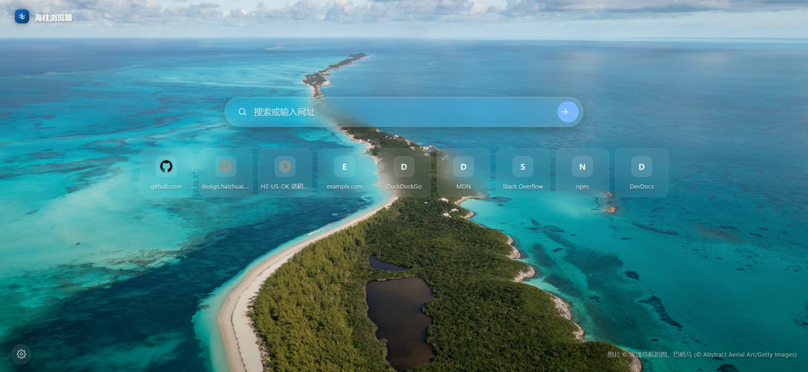
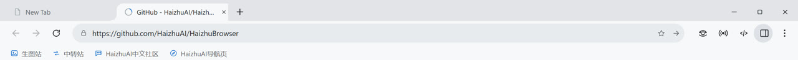
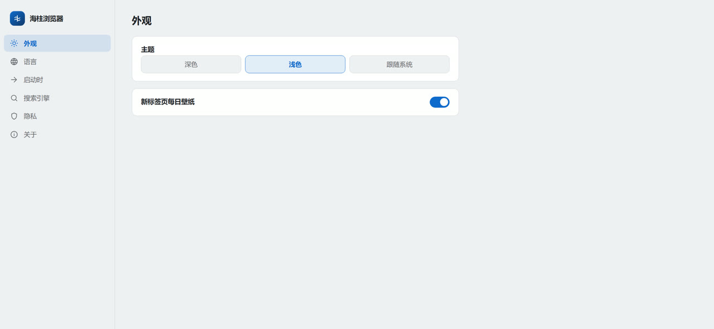
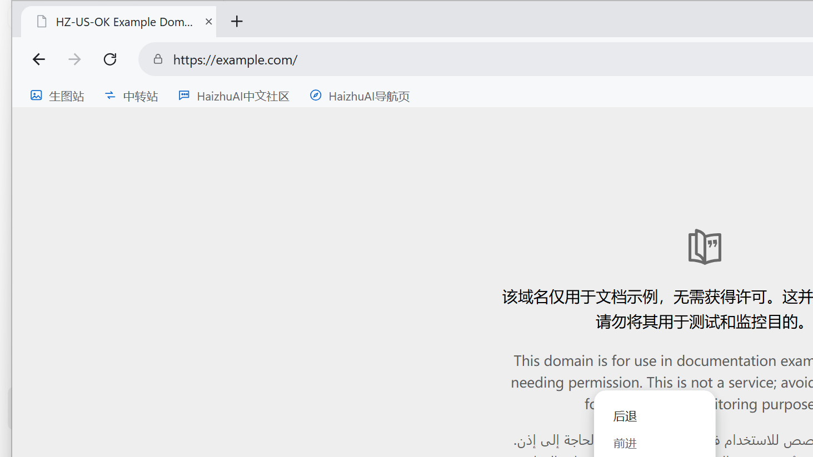
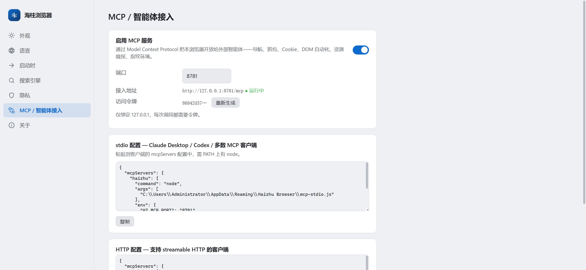
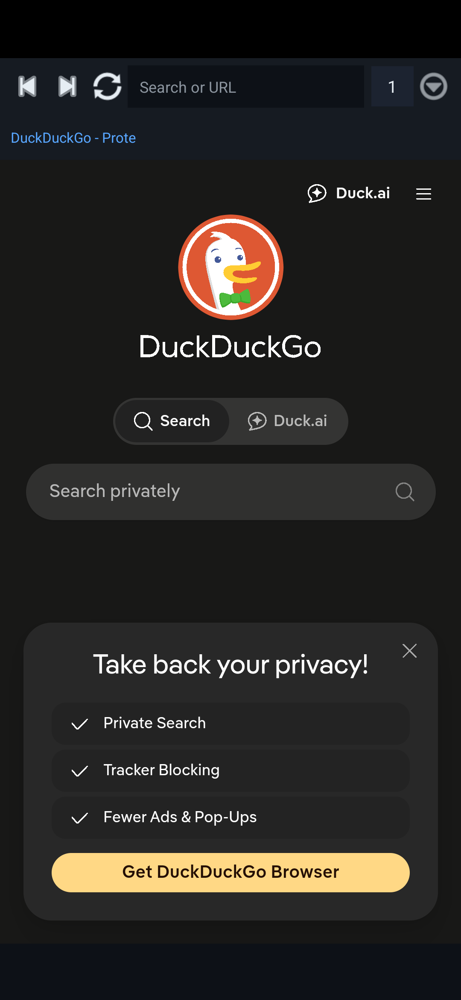
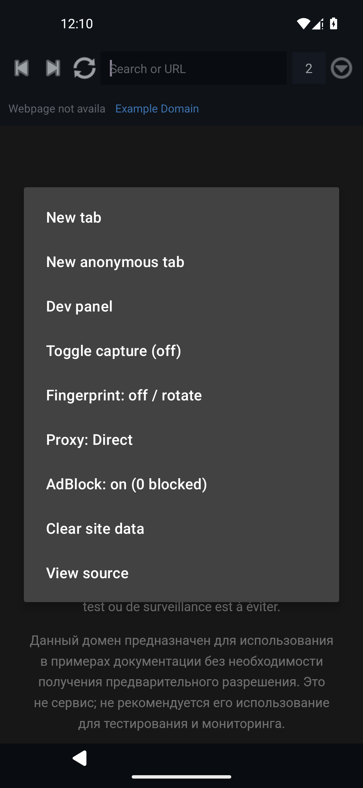
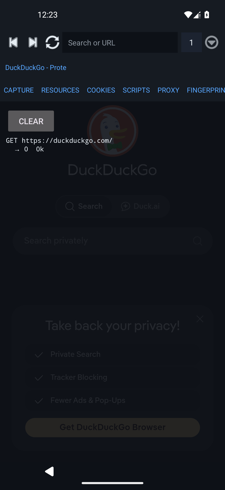
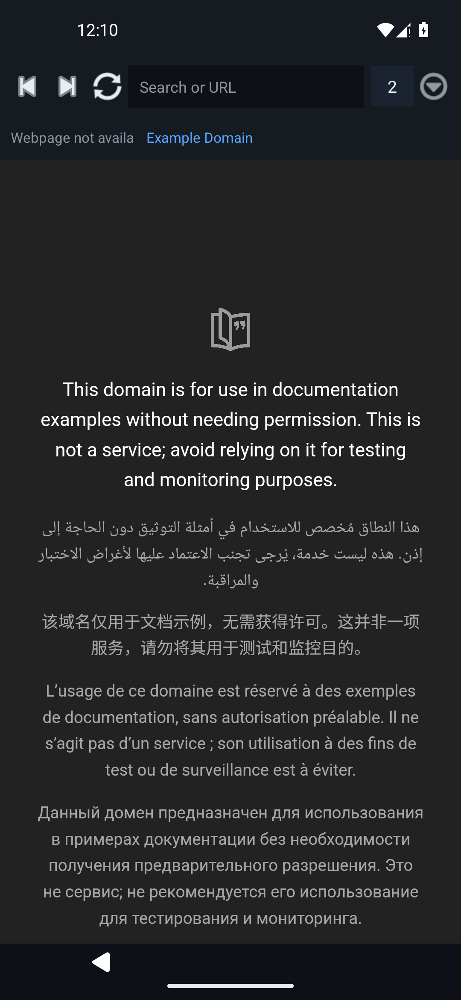

# Haizhu Browser

<p align="center"></p>

A high-performance, developer- and geek-oriented **all-in-one browser** — packet capture, proxy profiles, fingerprint spoofing, Chrome extensions, userscripts, media resource sniffer, and a built-in AI agent — across **Windows, Linux and Android**.

[中文 README](README.zh-CN.md)

## Screenshots

| New tab (Bing wallpaper NTP) | Chrome strip + bookmark bar |
|---|---|
|  |  |

| Settings (`haizhu://settings`) | Page context menu |
|---|---|
|  |  |

| MCP / agent integration (settings) |  |
|---|---|
|  |  |

| Android — main | Android — menu |
|---|---|
|  |  |

| Android — dev capture | Android — tabs |
|---|---|
|  |  |

## Features

| Module | Desktop (Win/Linux) | Android |
|---|---|---|
| **Packet capture** | Full CDP `Network` domain: headers, post data, response bodies, timing, HAR export | Request log via `shouldInterceptRequest` |
| **Resource sniffer** | Real-time m3u8/mpd/mp4/flv/m4s/mp3 detection, one-click HLS download (variant pick + parallel segments → `.ts`) | Same detection rules + downloader |
| **Userscripts** | Tampermonkey-compatible: `==UserScript==` metadata, `@match/@include/@exclude`, `@run-at`, full `GM_*` API surface (cross-origin XHR, clipboard, tabs, values, cookies, notifications, downloads) | Same engine semantics via `JavascriptInterface` bridge |
| **Extensions** | `session.loadExtension` — MV2 + MV3 (service-worker subset), install from `.zip`/`.crx`, toggle/remove | — |
| **Proxy** | HTTP/HTTPS/SOCKS4/SOCKS5/PAC profiles, per-session, auth support, bypass rules | `ProxyController` + OkHttp channel |
| **Environments** | Commercial-style isolated profiles (Bit Browser class): own partition + fingerprint seed + proxy binding + UA/UA-CH header rewrite; launch/reseed/duplicate/delete from the Environments panel | — |
| **Fingerprint spoofing** | Coherent device personas (CPU/RAM/GPU/screen/DPR bundled), CDP-native timezone/locale/UA-CH overrides, canvas/WebGL/audio/rects/battery/devices/voices/fonts/WebRTC — per-env seed-stable, CSP-immune injection | Same persona algorithm, document-start injection |
| **Anonymous tabs** | In-memory partitions + persona + proxy chain | Cookie-disabled WebView |
| **AdBlock** | EasyList/EasyPrivacy/EasyList-China subscriptions, `||domain^`/`\|anchor`/`@@`/`$type` grammar | Same rule engine |
| **AI assistant** | **Duck.ai built-in** (GPT-4o-mini / Llama / Claude / Mixtral / o3-mini) + import any **OpenAI-compatible endpoint** (base URL + key + model) | Same protocol layer |
| **AI Agent** | Tool loop: `navigate`, `list/set/delete cookies`, `network_log`, `request_body`, `resources`, `run_js`, `dom_query`, `click`, `fill`, `screenshot`, `page_text/html`, `storage_get`, `history` — analyzes captures and automates pages from chat | Same tool subset |
| **DevTools** | Native Chromium DevTools (F12 / right-dock) + custom panel | — |
| **Themes** | Dark / light / follow-system across all UI surfaces | System dark mode |
| **i18n** | English / 简体中文 / 繁體中文 / 日本語 — toolbar, menu, panel, NTP, settings | System strings |
| **New tab** | Edge-style immersive NTP: Bing daily wallpaper, frosted search, quick-link tiles | Simple NTP |
| **Settings** | `haizhu://settings` — appearance, language, startup, search engine, privacy, MCP, about | — |
| **MCP server** | Built-in **Model Context Protocol** endpoint — drive the whole browser from Claude Desktop / Codex / any MCP agent: tabs, navigation, DOM, cookies, capture+HAR, sniffing, environments, proxies, adblock, userscripts, AI | — |
| **Privacy** | Zero telemetry, zero ads, minimal permissions — verified against the Solo/Edge telemetry stacks we ripped out | Same |

## MCP — drive the browser from any agent

Haizhu Browser embeds a **Model Context Protocol** server so external AI agents
(Claude Desktop, Codex, custom agents…) can navigate pages, capture traffic,
read cookies, automate the DOM and manage fingerprint environments — the same
tool surface the built-in AI agent uses.

**Enable:** `haizhu://settings` → **MCP / Agents** → toggle on. The server binds
`127.0.0.1` only and requires a bearer token (auto-generated, regeneratable) —
nothing is reachable off-machine.

**Connect (two transports):**

- **stdio** — for clients that spawn MCP servers as child processes. Paste the
  generated config from Settings into your client's `mcpServers`:

  ```json
  {
    "mcpServers": {
      "haizhu": {
        "command": "node",
        "args": ["C:\\Users\\<you>\\AppData\\Roaming\\Haizhu Browser\\mcp-stdio.js"],
        "env": { "HZ_MCP_PORT": "8765", "HZ_MCP_TOKEN": "<token from settings>" }
      }
    }
  }
  ```

  The bridge script is written to `<userData>/mcp-stdio.js` automatically and
  forwards newline-delimited JSON-RPC into the running browser (needs `node` on
  `PATH`).

- **Streamable HTTP** — for clients that speak HTTP MCP directly:

  ```json
  { "mcpServers": { "haizhu": {
    "type": "http",
    "url": "http://127.0.0.1:8765/mcp",
    "headers": { "Authorization": "Bearer <token from settings>" }
  } } }
  ```

**Tool surface (36 tools):** `list_tabs` / `new_tab` / `close_tab` /
`activate_tab` / `navigate` (omnibox-style URL + search normalization) /
`get_url` / `page_text` / `page_html` / `dom_query` / `click` / `fill` /
`run_js` / `wait` / `screenshot` (real PNG image block) /
`start_capture` / `stop_capture` / `network_log` / `request_body` /
`har_export` / `resources` / `download_resource` /
`list_cookies` / `set_cookie` / `delete_cookie` / `storage_get` /
`list_profiles` / `launch_profile` / `profile_persona` /
`proxy_list` / `proxy_set` / `adblock_state` / `adblock_toggle` /
`list_scripts` / `bookmarks` / `history` / `ai_chat`.

A typical agent session: `start_capture` → `navigate` → `network_log` →
`request_body` → `har_export` gives you a full sniffed session; `dom_query` →
`click` → `fill` → `screenshot` drives page automation.

## Reverse-engineering pedigree

Feature design was informed by static analysis of 7 production browsers
(see [docs/RESEARCH.md](docs/RESEARCH.md)):

- **Stay** → userscript engine layout, Greasyfork flow, `sniffer.app.js` resource-probe pattern, HLS parsing
- **Via** → lightweight WebView architecture, per-site config, `via-fake-tampermonkey` shim idea, EasyList regional subscriptions
- **Solo** → full proxy stack shape, per-tab fingerprint, media sniff regexes (minus its ad-injection/telemetry, deliberately)
- **DuckDuckGo** → privacy checklist (tracking protection, HTTPS upgrade, encrypted storage), Duck.ai productization
- **Opera** → built-in ABP + VPN surface; **Edge** → Trust-Protection-List taxonomy; **Chrome** → baseline

## Install

Grab the latest [Release](../../releases):

| Platform | File |
|---|---|
| Windows | `HaizhuBrowser-x.y.z-win-x64.exe` (NSIS) or `-portable.exe` |
| Linux | `HaizhuBrowser-x.y.z-linux-x64.AppImage` / `.deb` |
| Android | `HaizhuBrowser-x.y.z-android.apk` (debug-signed; allow unknown sources) |

## Build from source

```bash
# Desktop — Node 20+
npm install
npm start            # run
npm run dist         # electron-builder → dist/ (nsis+portable / AppImage+deb)

# Android — JDK 17 + Android SDK 34
cd android
gradle assembleDebug   # → app/build/outputs/apk/debug/app-debug.apk
```

Tag-pushed builds are produced by `.github/workflows/build.yml` and attached to the GitHub Release automatically.

## Usage notes

- **Dev panel**: `F12` toggles the docked panel — Capture / Resources / Cookies / Scripts / Extensions / Proxy / Fingerprint / AI Agent.
- **Capture**: click ◉ in the toolbar or the panel's *Start capture*. Click a request for full headers + body; *Export HAR* saves a `.har`.
- **Resources**: any m3u8/mpd/media URL the tab touches lands here; **Grab** downloads HLS to `Downloads/haizhu-media/*.ts`.
- **Userscripts**: install from a `.user.js` URL (auto-intercepted) or write one in the panel. Greasyfork installs work out of the box.
- **Fingerprint**: enable → pick persona mode → *Rotate*. Applies at document-start in the main world, every frame.
- **AI**: chat with the built-in Duck.ai, or add your own endpoint (`+API`). The **Agent** button runs the tool loop against the current tab.
- **Proxy auth**: profiles with user/pass feed the Chromium `login` challenge automatically.

## Repo layout

```
src/main/        Electron main process (tabs, capture, userscripts, proxy, adblock, extensions, ai, fingerprint)
src/preload/     host (chrome UI) + page (GM bridge) preload scripts
src/renderer/    chrome UI + docked dev panel
android/         Kotlin WebView app mirroring the feature set
docs/RESEARCH.md APK reverse-engineering report
.github/workflows/build.yml  CI: win+linux+apk → release
```

## Roadmap

- Per-site config matrix (UA / JS / CSS injection per domain — Via-style)
- mitmproxy sidecar for full HTTPS capture with response bodies on Android
- Script marketplace sync (Greasyfork trending)
- HAR import + diff view, WebSocket frame viewer
- Release-signed APK + F-Droid build flavor

## License

GPL-3.0 — see [LICENSE](LICENSE).
