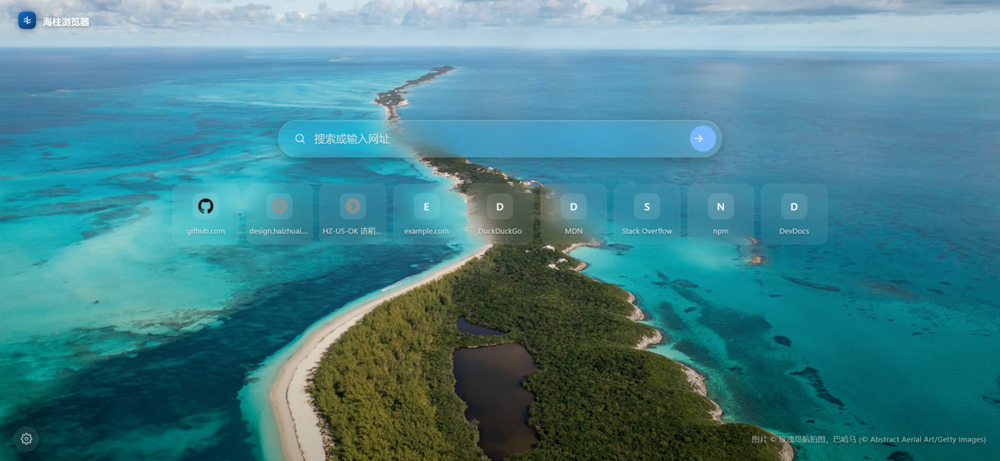
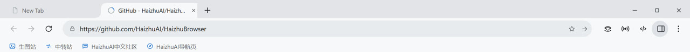
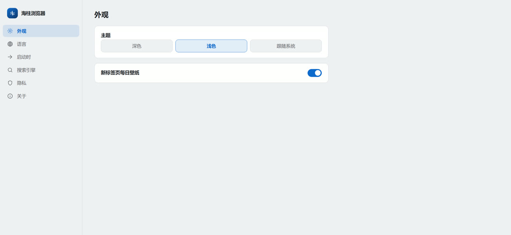

# Haizhu Browser 海柱浏览器

<p align="center"></p>

面向开发者与极客的**高性能一体化浏览器**——抓包调试、代理、指纹伪装、浏览器扩展、油猴脚本、资源嗅探抓取、内置 AI 助手与 Agent 自动化——覆盖 **Windows、Linux、Android** 三端。

[English README](README.md)

## 截图

| 新标签页（必应每日壁纸） | Chrome 条 + 书签栏 |
|---|---|
|  |  |

| 设置页（`haizhu://settings`） |
|---|
|  |

## 功能总览

| 模块 | 桌面版（Win/Linux） | 安卓版 |
|---|---|---|
| **抓包调试** | CDP `Network` 域全量捕获：请求/响应头、POST body、响应体、时序瀑布、HAR 导出 | `shouldInterceptRequest` 请求日志 |
| **资源嗅探** | 实时探测 m3u8/mpd/mp4/flv/m4s/mp3 等，一键 HLS 下载（自动选最高码率变体+并发分片→`.ts`） | 同规则探测+下载器 |
| **油猴脚本** | 完整兼容 Tampermonkey：`==UserScript==` 元数据、`@match/@include/@exclude`、`@run-at`、全量 `GM_*` API（跨域 XHR、剪贴板、新标签、键值存储、Cookie、通知、下载） | `JavascriptInterface` 桥接同语义引擎 |
| **浏览器扩展** | `session.loadExtension`：MV2 + MV3（service-worker 子集），支持 `.zip`/`.crx` 安装、启停、卸载 | — |
| **代理** | HTTP/HTTPS/SOCKS4/SOCKS5/PAC 配置档，按会话生效，支持账密鉴权与绕行规则 | `ProxyController` + OkHttp 通道 |
| **独立环境** | 商业化指纹环境（比特浏览器级）：独立分区 + 指纹种子 + 代理绑定 + UA/UA-CH 请求头改写；环境页支持启动/重种子/复制/删除 | — |
| **指纹伪装** | 一致性设备人格（CPU/内存/GPU/屏幕/DPR 打包）、CDP 原生时区/语言/UA-CH 覆盖、Canvas/WebGL/音频/矩形/电池/设备/语音/字体/WebRTC——按环境种子稳定、免 CSP 注入 | 同算法，document-start 注入 |
| **匿名标签** | 内存分区（不落盘）+ 指纹人格 + 代理链 | 禁用 Cookie 的独立 WebView |
| **广告拦截** | EasyList/EasyPrivacy/中文清单订阅，支持 `||domain^`/`\|锚点`/`@@例外`/`$类型` 语法 | 同一规则引擎 |
| **AI 助手** | **内置 Duck.ai**（GPT-4o-mini / Llama / Claude / Mixtral / o3-mini）+ 可导入任意 **OpenAI 兼容端点**（base URL + key + model） | 同一协议层 |
| **AI Agent** | 工具循环：`navigate`、`list/set/delete cookies`、`network_log`、`request_body`、`resources`、`run_js`、`dom_query`、`click`、`fill`、`screenshot`、`page_text/html`、`storage_get`、`history`——可在对话里分析抓包数据、操作页面自动化 | 同套工具子集 |
| **DevTools** | 原生 Chromium DevTools（F12/右侧停靠）+ 自研面板 | — |
| **主题** | 深色 / 浅色 / 跟随系统，全 UI 面生效 | 跟随系统深色 |
| **多语言** | English / 简体中文 / 繁體中文 / 日本語——工具栏、菜单、面板、新标签页、设置页全覆盖 | 系统字符串 |
| **新标签页** | Edge 式沉浸 NTP：必应每日壁纸、毛玻璃搜索、快捷瓷贴 | 简易 NTP |
| **设置页** | `haizhu://settings`——外观、语言、启动、搜索引擎、隐私、关于 | — |
| **隐私** | 零遥测、零广告、最小权限——剔除 Solo/Edge 同款遥测与广告注入栈 | 同 |

## 逆向渊源

功能设计源自对 7 款成品浏览器的静态分析（详见 [docs/RESEARCH.md](docs/RESEARCH.md)）：

- **Stay** → 油猴引擎布局、Greasyfork 流程、`sniffer.app.js` 资源探测方案、HLS 解析
- **Via** → 轻量 WebView 架构、按站点配置、伪装 TM shim 思路、EasyList 分区订阅
- **Solo** → 完整代理栈、按标签指纹、媒体嗅探正则（刻意剔除其广告注入与遥测）
- **鸭鸭(DuckDuckGo)** → 隐私清单（跟踪拦截、HTTPS 升级、加密存储）、Duck.ai 产品化路径
- **Opera** → 内置 ABP+VPN 形态；**Edge** → Trust Protection List 追踪分类法；**Chrome** → 基线

## 安装

到 [Release](../../releases) 下载：

| 平台 | 文件 |
|---|---|
| Windows | `HaizhuBrowser-x.y.z-win-x64.exe`（安装版）或 `-portable.exe`（绿色版） |
| Linux | `HaizhuBrowser-x.y.z-linux-x64.AppImage` / `.deb` |
| Android | `HaizhuBrowser-x.y.z-android.apk`（debug 签名；需允许未知来源） |

## 源码构建

```bash
# 桌面端 —— Node 20+
npm install
npm start            # 运行
npm run dist         # electron-builder → dist/（nsis+portable / AppImage+deb）

# 安卓端 —— JDK 17 + Android SDK 34
cd android
gradle assembleDebug   # → app/build/outputs/apk/debug/app-debug.apk
```

推送 `v*` tag 会触发 `.github/workflows/build.yml`，自动构建三端产物并附加到 GitHub Release。

## 使用说明

- **开发面板**：`F12` 开关右侧面板——Capture / Resources / Cookies / Scripts / Extensions / Proxy / Fingerprint / AI Agent 八页。
- **抓包**：工具栏 ◉ 或面板 *Start capture*；点任意请求查看完整头部+body；*Export HAR* 导出 `.har`。
- **资源嗅探**：标签页碰到的 m3u8/mpd/媒体地址都会进列表；**Grab** 把 HLS 下载到 `Downloads/haizhu-media/*.ts`。
- **油猴**：`.user.js` 链接自动拦截安装（Greasyfork 直装可用），或在面板里手写。
- **指纹**：启用→选人格模式→*Rotate*。主世界 document-start 注入，全 frame 生效。
- **AI**：内置 duck.ai 直接聊，或 `+API` 添加自有端点；**Agent** 按钮对当前标签页执行工具循环。
- **代理鉴权**：带账密的配置档自动应答 Chromium `login` 挑战。

## 仓库结构

```
src/main/        Electron 主进程（标签、抓包、油猴、代理、拦截、扩展、AI、指纹）
src/preload/     host（chrome UI）与 page（GM 桥）预加载脚本
src/renderer/    顶部 chrome UI + docked 开发面板
android/         Kotlin WebView 端，功能镜像
docs/RESEARCH.md APK 逆向调研报告
.github/workflows/build.yml  CI：win+linux+apk → release
```

## 路线图

- 按站点配置矩阵（UA/JS/CSS 域名级注入，Via 风格）
- mitmproxy 边车：安卓端带响应体的完整 HTTPS 抓包
- 脚本市场同步（Greasyfork trending）
- HAR 导入+对比、WebSocket 帧查看
- 正式签名 APK + F-Droid flavor

## 许可

GPL-3.0 —— 见 [LICENSE](LICENSE)。
